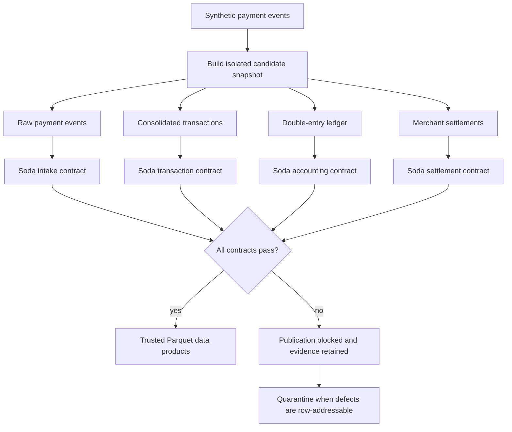

# Architecture

## Objective

The platform deploys data-quality controls at the financial boundaries of a daily fintech payment data flow so that failed controls prevent incorrect datasets from being published.

## Logical flow

The contracts are validation boundaries, not sequential orchestration checkpoints. The complete
candidate snapshot is built inside an isolated run so that every contract can be evaluated and the
full decision evidence can be retained. No trusted Parquet product is published unless all four
contracts pass.

## Components

### Synthetic source

The generator creates deterministic payment lifecycle events using a fixed random seed and an explicit execution date. Failure scenarios mutate the same valid baseline so that each rejected run has one intentional reason to fail.

### Parquet data lake

Parquet is the persistent interchange format. Datasets are separated into four logical layers:

- `raw`: source-aligned merchant and payment event data.
- `conformed`: consolidated payment transactions assembled from event history.
- `trusted`: ledger and settlement products released after quality approval.
- `quarantine`: invalid source records retained with rejection reasons.

Date columns are written as Hive-style directory partitions.

### DuckDB

DuckDB loads the Parquet inputs and performs SQL transformations. A persistent database is created
for every scenario so that Soda can inspect the exact candidate tables used by the pipeline and
reviewers can investigate them independently. The internal `trusted` schema contains the candidate
ledger and settlement models; within the isolated database, the schema name identifies their target
layer rather than their publication status. Publication occurs only when those tables are exported
to trusted Parquet storage after quality approval.

### Soda Core

Four Git-managed contracts evaluate quality at business boundaries:

1. Raw payment event intake.
2. Consolidated transaction state.
3. Double-entry accounting.
4. Merchant settlement publication.

Contracts use standard checks for schema, missing values, uniqueness, validity, and row count, plus metric and failed-row checks for financial invariants.

### Quality gate

The gate aggregates all contract outcomes and fails closed. Trusted Parquet output is exported only
when every contract passes. Soda evaluates quality; the pipeline owns the release decision. Failed
runs always retain evidence, while quarantine output is produced only for defects that can be tied
to individual source rows.

## Reproducibility

Each scenario uses an isolated run directory. No persistent service or mutable shared database is required. The same command produces the same logical data and quality outcome on a clean checkout.
